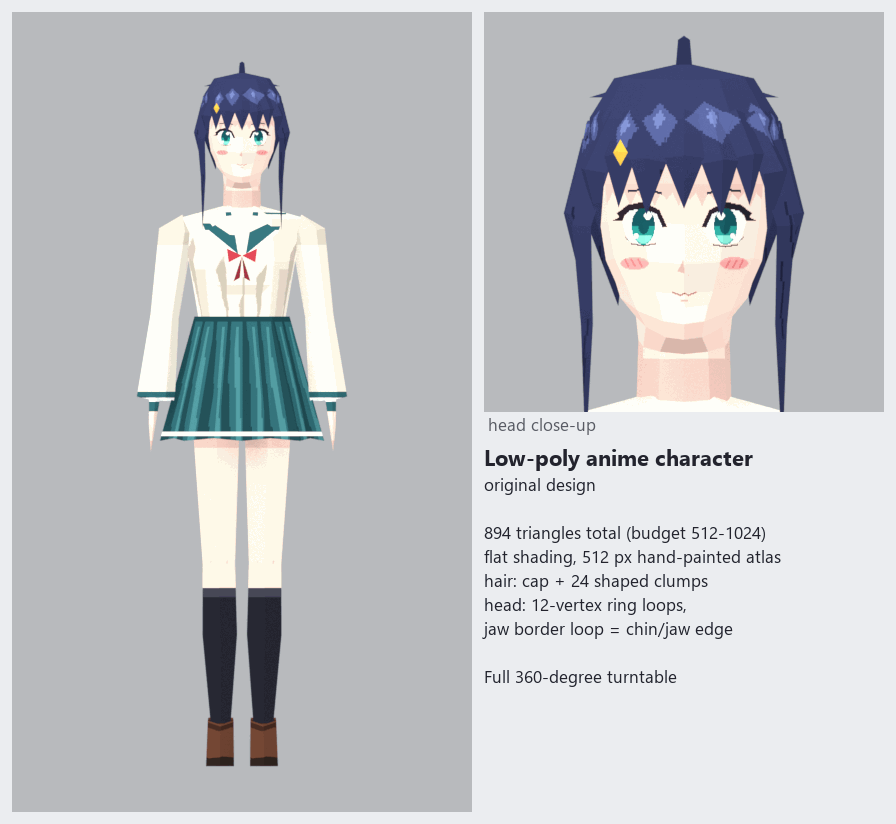
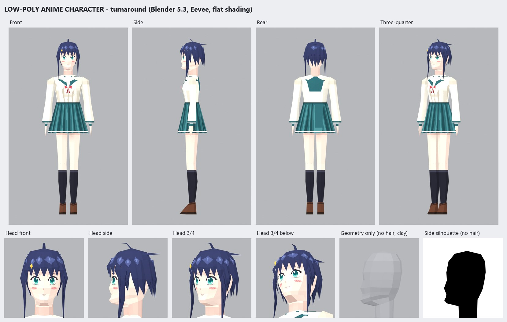
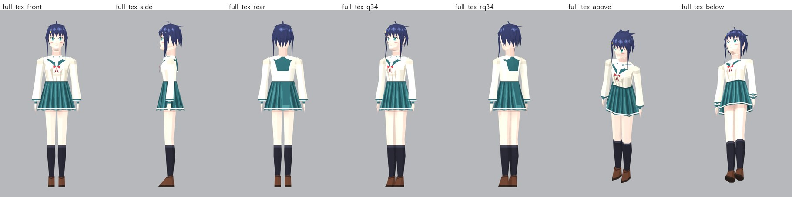
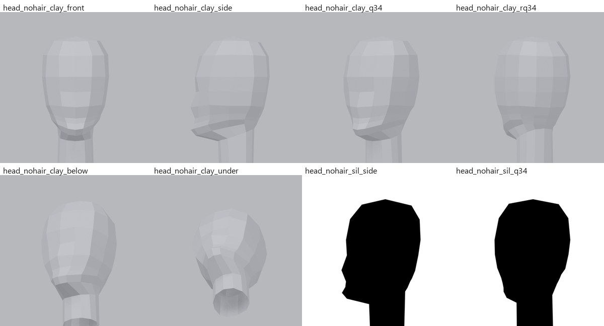
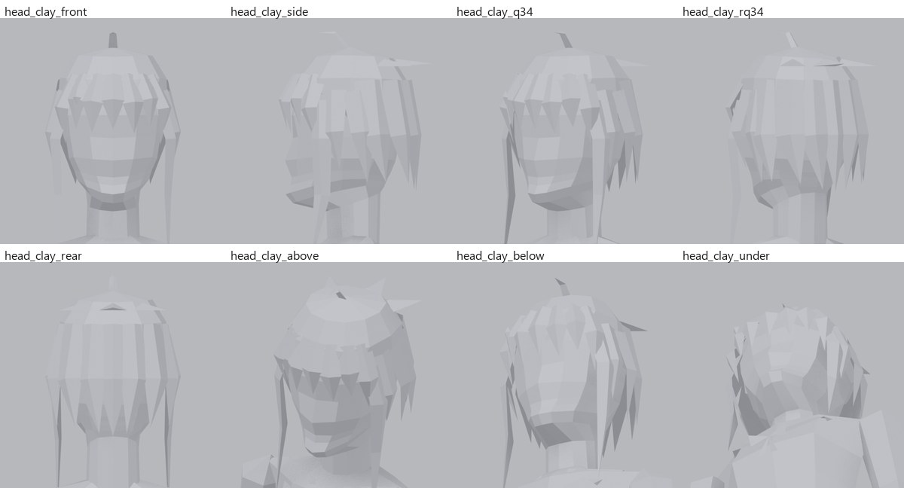
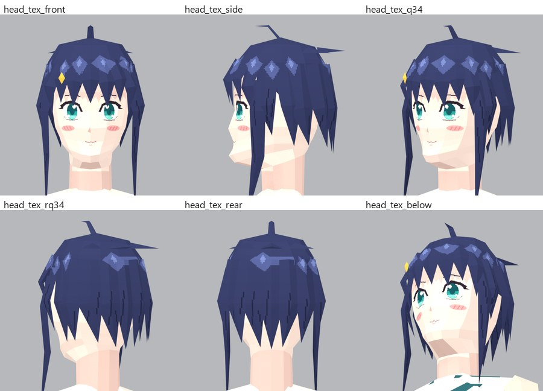
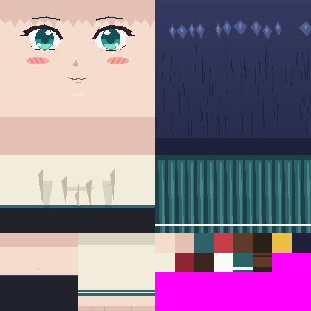
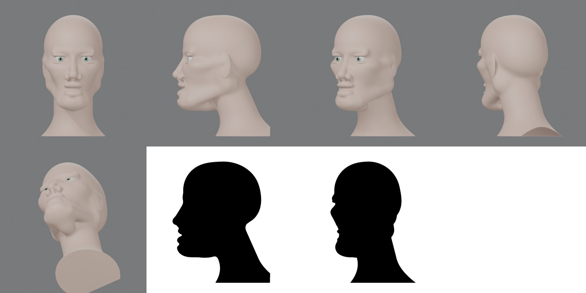
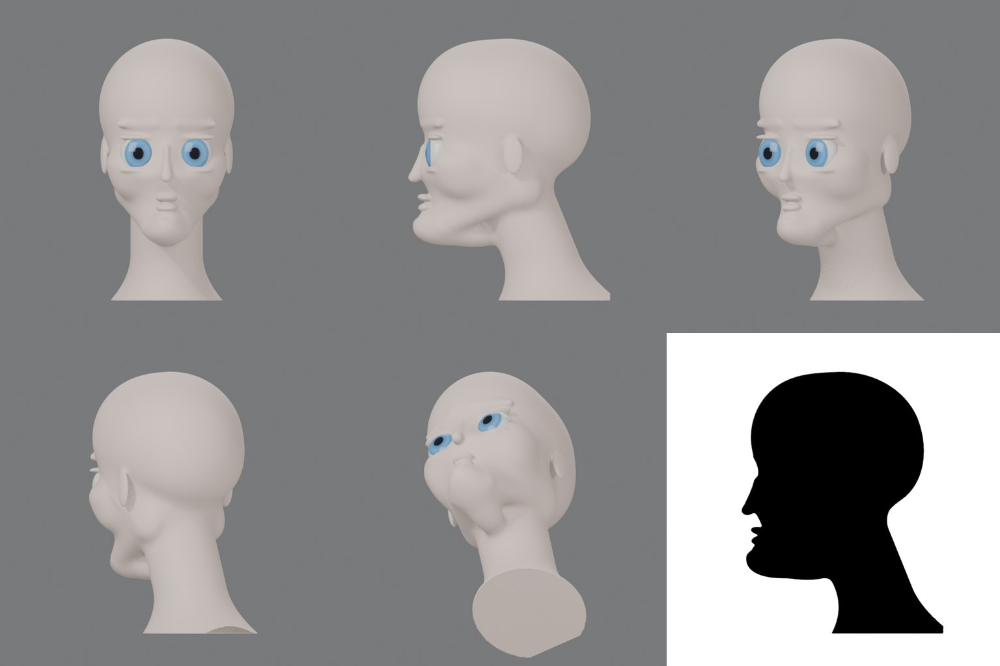
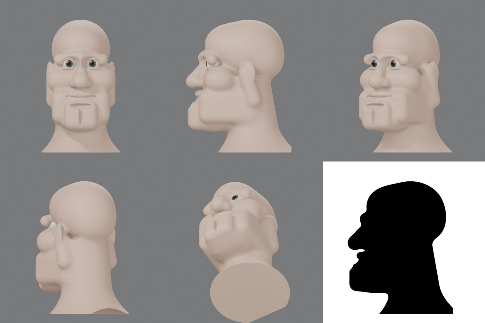

# Low-Poly Anime Character

An original PS1-style low-poly anime schoolgirl built in Blender 5.3 from Python. She has a navy bob with bangs, long front locks, an ahoge and a gold clip, and wears a cream sailor blouse with a teal collar and red ribbon, a teal pleated skirt, knee socks and loafers.

- **894 triangles** in total (budget 512–1024), counted from the saved file with every mesh object included and no modifiers
- 596 vertices, 13 mesh objects
- Flat shading, one 512×512 hand-painted texture with pixel-sharp sampling
- Every vertex is placed by a script (`scripts/build_character.py`); the head is 11 hand-placed loops of 12 vertices

**For an AI reviewer:** [`GPT_REVIEW_PACK.txt`](GPT_REVIEW_PACK.txt) has everything as plain text (description, head vertex table, stats, inspection log, full modeling notes). [`lowpoly_character.obj`](lowpoly_character.obj) is the whole mesh as text: centimetres, Z up, the character faces −Y.

Raw links:
- https://raw.githubusercontent.com/bv8dpwfzrj-sudo/lowpoly-anime-character/main/GPT_REVIEW_PACK.txt
- https://raw.githubusercontent.com/bv8dpwfzrj-sudo/lowpoly-anime-character/main/lowpoly_character.obj

## Turntable

## Turnaround

## Chin and jaw check

The head was checked with hair and clothing hidden, in grey clay and as black silhouettes, so the chin and jaw had to read from geometry alone. Below the mouth the head loops tilt down at the front, so one loop is the jawline itself, running from the chin up to under the ear. The jaw side sits above it, the jaw underside below it, and the neck starts behind.

| Measure (from the saved mesh) | Result | Anime target |
|---|---|---|
| Chin ahead of the mouth plane | 0.97 cm | 0.8–1.8 cm |
| Dent between lip and chin | 3 mm | 1–3 mm |
| Chin-to-neck (cervicomental) angle | 106° | 100–120° |
| Lower third of face | ≈5.5 cm | 5–6 cm |
| Lower lip behind nose–chin line (E-line) | ≈10 mm | 2–8 mm (mouth is painted, no lips modeled) |

## Triangle budget

| Group | Triangles | Share | Contents |
|---|---|---|---|
| Hair | 294 | 33% | cap 84 + 24 clumps (7 bangs, 4 side, 2 long locks, 7 back, 3 crown spikes, ahoge) |
| Head + neck | 252 | 28% | 11 rings × 12 vertices + crown fan |
| Clothing | 172 | 19% | blouse/torso 102, sailor collar 14, skirt 24, shoes 2 × 16 |
| Body | 168 | 19% | arms + hands 2 × 48, legs 2 × 36 |
| Accessories | 8 | 1% | ribbon 4, hair clip 4 |
| **Total** | **894** | | 130 left in the budget |

The single texture:

## Limitations

- No rig or armature.
- The mouth and expression are painted, so there are no modeled lips.

## Earlier test heads (v1)

Three heads sculpted from distance-field shapes to study the chin, jaw underside and neck: semi-realistic, anime and cartoon. Video: [`images/heads_side_by_side.mp4`](images/heads_side_by_side.mp4).

